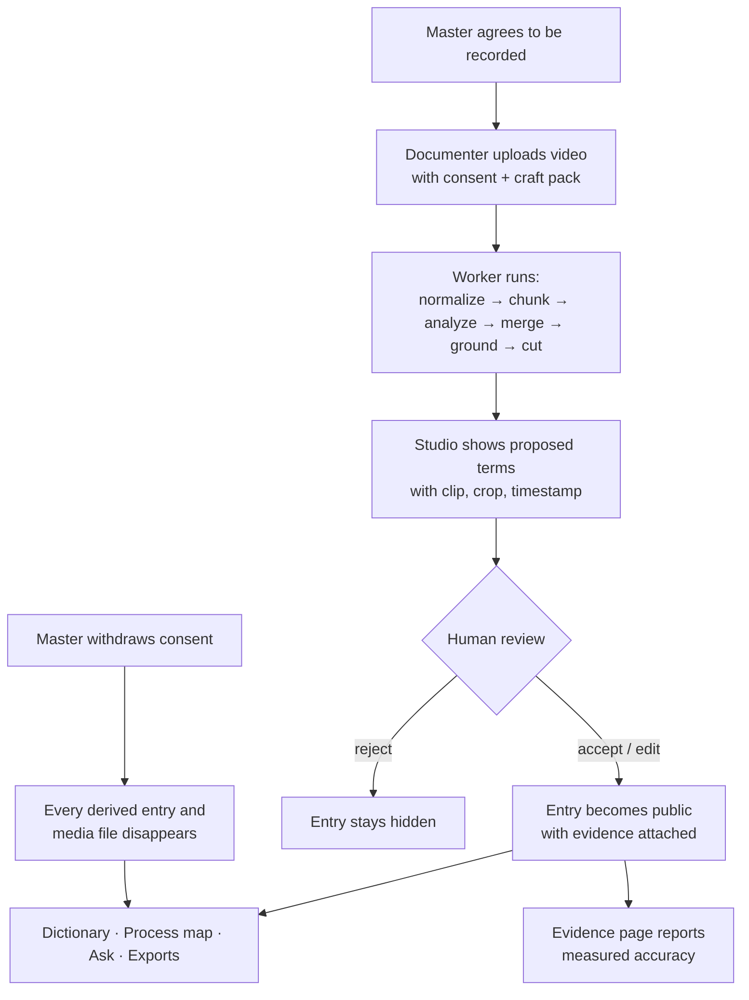
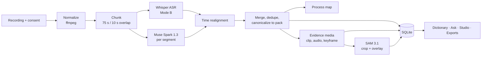
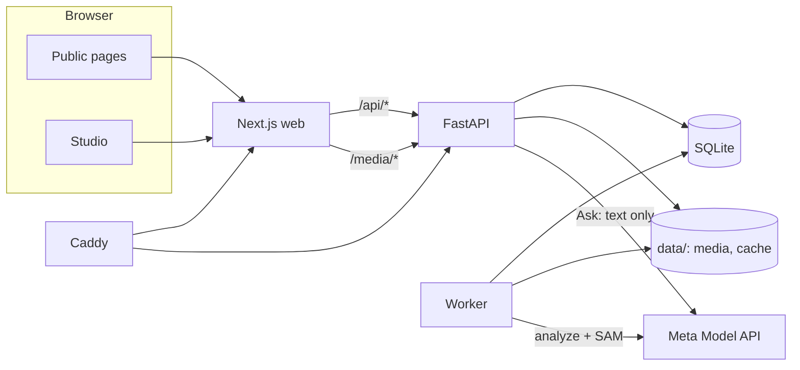

# Empu — Batik Tulis Edition

**Capture what masters know, before it's gone.**

Empu turns a master's narrated work video into a watchable, searchable craft dictionary. Every
term is tied to the moment it was said, a clip of the motion, and — where the tool is visible — a
crop of the real tool. AI proposes; a human decides. Nothing is published until a validator
accepts it.

Ask the archive anything and the answer is drawn only from validated entries — with the clip,
the crop, and the timestamp it stands on. If no archive covers the question, Empu says so.

- **First edition:** Batik Tulis (`packs/batik_tulis.yaml`)
- **Also included:** a draft Gamelan craft pack (`packs/gamelan.yaml`)
- **Built for:** Meta Global AI Developer Hackathon 2026, Indie track
- **Full feature inventory:** [`docs/konteks-fitur.md`](docs/konteks-fitur.md) (Indonesian)

[](https://youtu.be/wIQXleQcuuw?si=rK-mawE18T669tih)

▶ **[Watch the 4-minute demo on YouTube](https://youtu.be/wIQXleQcuuw?si=rK-mawE18T669tih)** —
upload, human review, dictionary, Ask, and evidence, start to finish.

**Jump to:** [Demo](#demo-video) · [Why](#why-this-exists) · [Features](#what-you-can-do) ·
[Workflow](#how-it-works-end-to-end-workflow) · [Screens](#screens) · [Stack](#stack) ·
[Architecture](#architecture) · [Quickstart](#quickstart) · [CLI](#cli) · [API](#api-overview) ·
[Configuration](#configuration) · [Testing](#testing) · [Deployment](#deployment) ·
[Evaluation](#evaluation) · [Craft packs](#craft-packs) ·
[Data & licensing](#data-consent-and-licensing) · [Limitations](#status-and-limitations)

---

## Demo video

[](https://youtu.be/wIQXleQcuuw?si=rK-mawE18T669tih)

**https://youtu.be/wIQXleQcuuw**

The demo walks through the whole product in order:

1. A raw recording of a batik master at work, uploaded with consent and a craft pack.
2. The pipeline running in the Studio — segments, terms, timestamps, tool crops.
3. A human accepting, editing, and rejecting proposed terms.
4. The published dictionary: a term with its clip, crop, gloss, source label, and timestamp.
5. The process map: the craft's stages in order.
6. Ask Empu answering a question with citations back to the exact moment.
7. The evidence page with measured numbers and the numbers that miss the target.

> Prefer to run it yourself? [Quickstart](#quickstart) gets the full stack running locally in
> three terminals.

---

## Why this exists

Masters carry knowledge that was never written down: the names of tools and their parts
(*nyamplung*, *cucuk*), the names of stages (*nglowong*, *nembok*, *nglorod*), local terms, and
the way each motion is actually done. Recording is easy. Processing is the expensive part —
transcribing, finding terms, writing glosses, and linking each term back to the gesture it
describes. Most recordings stay raw files.

General-purpose speech recognition also fails on craft vocabulary. Automatic subtitles render
*spangkring* as "spang King", *waterglass* as "watera gelas", and *nglorod* as "ngelorot".

Empu closes that gap with a human-validated pipeline, not a summarizer.

| The usual shortcut | What Empu does instead |
|---|---|
| Transcribe the video and call it knowledge | Extracts craft *terms* with timestamps, glosses, stages, and tool crops |
| Trust the model's output | Every public entry passed a human review; every claim carries its evidence |
| One hard-coded domain | Craft knowledge lives in swappable YAML packs — batik today, gamelan next |
| Answer however the model likes | Answers must cite real `entry_ids` or they are refused |
| Keep the recording forever | Consent is recorded up front and can be withdrawn in one click |

---

## What you can do

### Public dictionary

- **Browse archives** at `/` with a sample term from each collection.
- **Search and filter** at `/d/[slug]` by category, process stage, and newly discovered terms.
- **Open a term** at `/d/[slug]/[id]`: evidence clip with audio, pronunciation audio, SAM crop,
  Indonesian and English glosses, spelling variants, source label, confidence, timestamp,
  contributor, and every other recording where the term appears.
- **Read the process** at `/map`: the stages of the craft in order, each holding the terms and
  thumbnails that belong to it.
- **Check the evidence** at `/evidence`: measured recall, precision, time error, source-label
  accuracy, ASR baseline, and the music-only control result — including numbers that miss the
  target.

### Ask Empu

One door at `/ask` answers across every public archive in a single question.

- Every answer must cite `entry_ids`; an answer that cannot be tied to a visible term is
  refused instead of guessed.
- Evidence is re-read from the database on every request, so a consent withdrawal or a rejected
  occurrence takes effect even when the answer text came from cache.
- Each citation carries its archive, clip, crop, and timestamp.
- Public rate limit: 40 questions per IP per hour by default (`EMPU_ASK_PER_HOUR`).
- Answers are cached in `data/cache/ask`; prompt version `ask-v5`.

### Studio (validation)

The Studio is the human side of the pipeline. It requires `STUDIO_KEY`.

- **Upload** a recording with title, contributor, location, source kind, consent scope, and access
  level. Consent is mandatory. CC BY videos must carry creator, URL, license, and attribution.
  (The API also accepts recorded date, language hint, and consent evidence.)
- **Watch progress** through normalize → chunk → analyze → merge → ground → cut → ready.
- **Review terms** with the video and timeline markers side by side:
  - `A` accept, `E` edit, `R` reject, `J`/`K` next/previous, `Esc` close.
  - Merge duplicates, write a maestro note, restore a rejected entry.
  - Every action writes a `review_event` with before/after state and actor.
- **Withdraw consent** for a recording in one click; every derived occurrence and media file
  disappears from the dictionary, Ask, and exports.
- **Ask the studio** across entries still under review, to see what the pipeline caught before
  publication.
- **Export** JSON, CSV, ELAN, or ZIP for public entries or all entries.
- **Manage craft packs** in the browser: validate YAML, create a new pack, load an existing one
  as a template.

### Sandbox

`/try` lets a visitor upload without a studio key.

- Maximum 3 minutes and 80 MB per upload.
- Daily quota: 30 jobs (`EMPU_SANDBOX_DAILY_QUOTA`).
- The sandbox archive is private and unlisted: it is excluded from the public archive list, the
  public dictionary, and public Ask.

### Exports

One archive, four formats, two scopes.

| Format | Contents |
|---|---|
| JSON | Manifest, contributors, recordings, entries with occurrences, process maps |
| CSV | One row per occurrence: term, category, stage, glosses, variants, status, maestro, timing, source, confidence, clip path |
| ELAN (`.eaf`) | Time-aligned tiers per recording: `term`, `spoken`, `gloss-id`, `gloss-en`, `source`, `stage` |
| ZIP | JSON + CSV + ELAN + media (clips, audio, crops) + `README.txt` with attribution |

`scope=public` is readable without a key; `scope=all` includes proposed and rejected entries and
requires the studio key.

### CLI and API

Everything the Studio does is also a command or an HTTP route, so the archive can be processed
and exported without opening a browser. See [CLI](#cli) and [API](#api-overview).

---

## The trust model

These rules are enforced in code, not just in copy.

1. **AI proposes, a human decides.** An entry is public only when its status is `accepted` or
   `edited`, its access level is `public`, its source recording has granted public consent, it
   has at least one public occurrence, and — for CC BY videos — attribution is complete.
2. **Evidence is always visible.** Every entry shows its clip, timestamp, source, and confidence.
3. **Source labels never disappear.** `speech`, `on_screen_text`, and `visual_only` are preserved
   in the database, API, UI, and exports.
4. **Original frames only.** Every image is a frame from the recording. No AI-generated imagery.
5. **Consent first.** A recording is never processed without a consent record. Consent can be
   withdrawn, and withdrawal immediately hides all derived content.
6. **Attribution.** The master is named on every entry and in every export.
7. **Craft knowledge lives in packs.** Pipeline code contains no batik-specific vocabulary;
   adding a craft means adding a YAML file.

Validation language is honest too. "Validated by the expert" is used only when a non-documenter
actor actually reviewed the entry. Everything else says "Validated by the documenter".

---

## How it works (end-to-end workflow)

### The three roles

| Role | Who | What they do |
|---|---|---|
| **Master / contributor** | The craftsman on camera | Works and narrates; gives consent; may review entries |
| **Documenter** | Archive owner with `STUDIO_KEY` | Uploads, watches the pipeline, validates terms, exports |
| **Visitor** | Anyone, no key | Reads the dictionary, browses the process map, asks questions, tries the sandbox |

### The flow, step by step



1. **Consent is recorded.** No recording enters the system without a consent scope (`public`,
   `community`, or `private`) and a note on how it was given.
2. **The recording is uploaded.** The original file is stored untouched; a `job` row is created.
3. **The worker processes it.** The video is normalized, split into overlapping segments, and
   analyzed segment by segment. Terms come back with timestamps, sources, glosses, confidence,
   and process steps.
4. **Results are merged and canonicalized.** Overlapping duplicates collapse; spoken terms are
   matched to the craft pack's vocabulary; unmatched terms are flagged as novel.
5. **Evidence media is cut.** A short clip, a pronunciation audio file, and a keyframe are
   produced for the best occurrence of every term. SAM crops the tool or material when it is
   visible.
6. **A human reviews.** Accept, edit, reject, or merge — with the video and timeline in view.
   Each action is written to `review_event` with before/after state.
7. **Accepted public entries appear** in the dictionary, the process map, Ask, and exports.
8. **The archive can be asked questions.** Answers are assembled only from visible entries and
   must cite them.

### The pipeline



1. **Intake** — validate consent, store the original untouched, create a job.
2. **Normalize** — `analysis.mp4` at 480p for Muse, `display.mp4` at 720p for clips.
3. **Chunk** — 75-second windows with 10 seconds of overlap, processed in parallel.
4. **Analyze** — Muse Spark 1.3 receives the segment plus craft-pack context and returns terms,
   timestamps, sources, visible objects, glosses, confidence, and process steps.
   Responses are cached by segment hash, model, prompt version, and mode.
5. **Realign (Mode B)** — local faster-whisper supplies word timestamps; Muse's times are
   fuzzy-matched to the transcript window. Speech spelling still comes from Muse.
6. **Merge** — shift timestamps, dedupe overlap, canonicalize terms against pack variants,
   flag novel terms, and group occurrences into one entry per term per archive.
7. **Ground** — SAM 3.1 crops the tool or material from the best keyframe, with a full-frame
   fallback when nothing is found.
8. **Review** — a human accepts, edits, rejects, or merges. Only then can an entry go public.

Pipeline statuses:

```
queued → normalizing → chunking → analyzing → merging → grounding → cutting → ready
                                                                   ↘ failed
```

The queue is a database table, not Redis. One worker processes one job at a time and requeues
stale jobs after a restart.

### What happens when consent is withdrawn

One request sets the recording's consent to withdrawn. From that moment:

- every occurrence from that recording is excluded from the dictionary, Ask, and exports;
- an entry with no remaining public occurrence disappears with it;
- the derived media (clips, audio, crops) is removed;
- cached Ask answers are still re-hydrated from the database, so a cached sentence cannot
  resurrect withdrawn evidence.

---

## Screens

| Route | Screen | Access |
|---|---|---|
| `/` | Home and archive list | Public |
| `/d/[slug]` | Dictionary for one archive | Public |
| `/d/[slug]/[id]` | Term detail with evidence | Public |
| `/map` · `/d/[slug]/map/[recordingId]` | Process map | Public |
| `/ask` | Ask Empu across all archives | Public |
| `/evidence` | Evaluation results | Public |
| `/try` | Sandbox upload | Public, quota |
| `/studio` | Studio home | Studio key |
| `/studio/upload` | Upload a recording | Studio key |
| `/studio/jobs/[id]` | Job progress | Studio key |
| `/studio/recordings/[id]` | Validation workspace | Studio key |
| `/studio/ask` | Ask within one archive, including proposed entries | Studio key |
| `/studio/export` | Export JSON / CSV / ELAN / ZIP | Studio key |
| `/studio/packs` | Craft pack editor and validator | Studio key |

---

## Stack

| Layer | Technology | Why |
|---|---|---|
| API | Python 3.12, FastAPI, Pydantic v2 | Typed request/response models, OpenAPI for free |
| Data | SQLModel over SQLite | One file to ship and back up; the queue is a table |
| Pipeline | ffmpeg / ffprobe, PyAV, faster-whisper | Deterministic media work locally, no upload of the raw file for ASR |
| Analysis | Meta Muse Spark 1.3 | Understands video and audio together and returns structured JSON |
| Grounding | Meta SAM 3.1 | Crops the tool from an original frame using an English text prompt |
| Text matching | rapidfuzz | Fuzzy canonicalization of spoken terms against pack variants |
| Annotation | `pympi-ling` | ELAN `.eaf` export for linguists |
| CLI | Typer | `empu analyze`, `ingest`, `process`, `eval`, `ask warm` |
| Resilience | httpx + tenacity | Retries with backoff on 429/5xx, single client module |
| Web | Next.js 16 (App Router), React 19, TypeScript | Server-rendered public pages, one API client |
| Styling | Tailwind CSS 4, Lucide icons | Modernist design system: Archivo, 2 px rules, red accent |
| Web tests | Vitest | Component and API-client tests without a browser |
| Deploy | Docker Compose: web, api, worker, Caddy | TLS, `/api/*` and `/media/*` proxying, Range support |

Model calls go through exactly one module, `api/empu/meta_client.py`. Raw responses are cached
so a reprocess never pays twice for unchanged input.

---

## Architecture



### Repository layout

```
Empu/
├── api/empu/              # API, pipeline, worker, CLI
│   ├── routes/            # FastAPI routers
│   ├── pipeline/          # normalize → chunk → analyze → merge → ground → evidence
│   ├── ask/               # retrieval, prompt, citation engine, rate limit
│   ├── evaluation/        # metrics, baselines, gold answers, retrieval
│   └── export/            # JSON, CSV, ELAN, ZIP
├── api/tests/             # pytest suite and recorded fixtures
├── web/                   # Next.js app, components, API client
├── packs/                 # craft knowledge as YAML
├── deploy/                # Dockerfiles, compose, Caddyfile
├── docs/                  # design spec, feature context, evaluation material
└── data/                  # runtime: SQLite, media, cache (not committed)
```

### Data model at a glance

| Table | Holds |
|---|---|
| `archive` | One collection: slug, title, craft pack, license, sandbox flag |
| `contributor` | Master, student, or documenter — name, region, sanggar |
| `recording` | Source video, consent record, source kind, attribution, duration |
| `job` | Pipeline run: status, progress, model, prompt version, usage, timings |
| `chunk` | Segment of a recording: window, hash, cache paths, latency |
| `entry` | One term in one archive: glosses, variants, status, crop, best occurrence |
| `occurrence` | One mention: spoken form, source, timestamps, clip, audio, keyframe |
| `process_step` | One stage in the craft's process map |
| `review_event` | Every human decision, with before/after state and actor |

Media lives under `data/archives/<archive_id>/…`, model and Ask caches under `data/cache/…`.

---

## Quickstart

### Prerequisites

- Python 3.12
- [uv](https://docs.astral.sh/uv/)
- Node.js 20+ and pnpm 10
- `ffmpeg` and `ffprobe` on `PATH`
- A Meta Model API key

### 1. Configure

```bash
cp .env.example .env
```

Set at least:

```dotenv
META_MODEL_API_KEY=...
STUDIO_KEY=choose-a-long-random-string
```

All other defaults are safe for local development. Mode B, structured output, and SAM are on by
default because they passed the Gate 0 feasibility tests.

### 2. Install and initialize

```bash
cd api
uv sync
uv run empu db init
```

### 3. Run the three processes

```bash
# Terminal 1 — API
cd api
uv run uvicorn empu.app:create_app --factory --reload --port 8000

# Terminal 2 — worker
cd api
uv run python -m empu.worker

# Terminal 3 — web
cd web
pnpm install
pnpm dev            # http://localhost:3000
```

Open `http://localhost:3000`. The public site works without a key; `/studio` asks for
`STUDIO_KEY`.

### 4. Add your first recording

Use `/studio/upload`, or the CLI:

```bash
cd api
uv run empu ingest ../path/to/video.mp4 \
  --archive my-archive \
  --archive-title "Living Archive · My Craft" \
  --pack batik_tulis \
  --contributor "Master Name" \
  --consent-confirmed \
  --consent-scope public \
  --run
```

Then validate the proposed terms in `/studio/recordings/<id>`. Accepted public entries appear in
`/d/my-archive`.

---

## CLI

```bash
cd api

# Analysis without a server
uv run empu analyze ../path/to/video.mp4 --pack batik_tulis --out ../data/runs/demo

# Database
uv run empu db init [--reset]

# Ingestion
uv run empu ingest ../path/to/video.mp4 --archive <slug> [--pack <id>] [--run]
uv run empu reprocess <recording_id> [--mode A|B] [--run]
uv run empu process <job_id>
uv run empu status [--archive <slug>]
uv run empu recording edit <id> [--title ...] [--source-kind ...]

# Evaluation
uv run empu eval run --set ../docs/eval/test-set.yaml --gold ../docs/eval/kunci-jawaban --out eval/results/latest.json
uv run empu eval draft-gold <clip_id>
uv run empu eval retrieval --questions ../docs/demo/questions.txt [--archive <slug>] [--scope public|studio]

# Warm the Ask cache before a demo
uv run empu ask warm --questions ../docs/demo/questions.txt
```

---

## API overview

Public routes need no key:

```text
GET  /api/health
GET  /api/packs
GET  /api/packs/{id}
GET  /api/public/archives
GET  /api/public/archives/{slug}
GET  /api/public/archives/{slug}/entries
GET  /api/public/archives/{slug}/recordings
GET  /api/public/entries/{id}
GET  /api/public/recordings/{id}/process-map
POST /api/public/ask
POST /api/public/archives/{slug}/ask
POST /api/sandbox/recordings
GET  /api/eval/summary
GET  /media/{path}            # public files only; studio files need the key
```

Studio routes need `X-Studio-Key`:

```text
GET/POST /api/archives
GET      /api/archives/{id}
GET/POST /api/archives/{id}/recordings
GET      /api/archives/{id}/entries
GET      /api/archives/{id}/export?format=json|csv|eaf|zip&scope=public|all
POST     /api/archives/{id}/ask
GET      /api/recordings/{id}
GET      /api/recordings/{id}/entries
GET      /api/recordings/{id}/process-map
POST     /api/recordings/{id}/reprocess
POST     /api/recordings/{id}/withdraw-consent
GET      /api/jobs/{id}
GET      /api/entries/{id}
POST     /api/entries/{id}/review
GET      /api/packs/{id}/source
POST     /api/packs/validate
POST     /api/packs
```

`POST /api/entries/{id}/review` accepts `accept`, `edit`, `reject`, `merge`, and `restore`.
The `add_manual` action is defined but not implemented.

`GET /api/archives/{id}/export` is readable without a key when `scope=public`; `scope=all`
requires the studio key.

---

## Configuration

Everything is read from `.env` at the repository root. See `.env.example`.

| Variable | Default | Purpose |
|---|---|---|
| `META_MODEL_API_KEY` | — | Meta Model API key |
| `STUDIO_KEY` | — | Studio write key |
| `MUSE_MODEL` | `muse-spark-1.3` | Analysis model |
| `SAM_MODEL` | `sam-3.1` | Crop model |
| `EMPU_DATA_DIR` | `./data` | Database, media, cache |
| `EMPU_PACKS_DIR` | `./packs` | Craft pack directory |
| `EMPU_PIPELINE_MODE` | `B` | `A` (Muse-native) or `B` (ASR-assisted) |
| `EMPU_CHUNK_WINDOW_S` | `75` | Segment window |
| `EMPU_CHUNK_OVERLAP_S` | `10` | Segment overlap |
| `EMPU_ANALYZE_CONCURRENCY` | `3` | Parallel segment analyses |
| `EMPU_SAM_ENABLED` | `true` | Enable SAM crops |
| `EMPU_TRANSCRIBE_BACKEND` | `whisper` | ASR backend for Mode B |
| `EMPU_MAX_UPLOAD_MB` | `500` | Upload size cap |
| `EMPU_MAX_DURATION_S` | `1200` | Recording length cap |
| `EMPU_SANDBOX_MAX_DURATION_S` | `180` | Sandbox length cap |
| `EMPU_SANDBOX_DAILY_QUOTA` | `30` | Sandbox jobs per day |
| `EMPU_ASK_PER_HOUR` | `40` | Ask rate limit per IP |
| `EMPU_ASK_MAX_ENTRIES` | `60` | Entries per Ask prompt |
| `EMPU_DOMAIN` | — | Domain for Caddy in Docker |
| `EMPU_API_ORIGIN` | `http://127.0.0.1:8000` | API origin used by the web app |

Secrets belong in `.env` only. Never commit them or print them in logs.

---

## Testing

The pipeline and API are tested against recorded fixtures; tests never call the real API.

```bash
cd api
uv run pytest -q
uv run ruff check .
uv run ruff format --check .

cd ../web
pnpm lint
pnpm test
pnpm build
```

---

## Deployment

`deploy/docker-compose.yml` runs four services: `api`, `worker`, `web`, and `caddy`.
Caddy terminates TLS and proxies `/api/*` and `/media/*` to the API, and everything else to the
web app.

```bash
cd deploy
EMPU_DOMAIN=your-domain.example docker compose up -d --build
```

Requirements:

- `EMPU_DOMAIN` set so Caddy can obtain a certificate.
- `.env` at the repository root with the API key and studio key.
- A writable `data/` directory mounted into `api` and `worker`.
- The API port should not be published to the internet; Caddy and the worker are the only
  clients.

---

## Craft packs

A craft pack is a YAML file in `packs/` that describes one skill: its stages, seed terms,
variants, glosses, and visual prompts. The pipeline treats those terms as examples, never as a
mandatory list, so it can also surface terms the pack does not know.

```yaml
id: gamelan
version: 0.1.0
name: {id: Gamelan, en: Javanese gamelan}
languages: [id, jv]
prompt_context: >
  Context that helps the model read this craft correctly.

stages:
  - id: penyiapan
    label: {id: Menyiapkan instrumen, en: Preparing the instruments}
    variants: [menyiapkan, menyetem]
  - id: tabuhan
    label: {id: Menabuh, en: Playing}
    variants: [menabuh, tabuhan]

terms:
  - id: saron
    label: saron
    category: tool
    variants: [saron, saron barung]
    stage: tabuhan
    gloss_id: alat pukul perunggu berbilang bilah
    gloss_en: bronze metallophone
    visual: true
    sam_prompt: bronze metallophone with wooden bars
    verified: false
```

Valid categories: `tool`, `tool_part`, `material`, `dye`, `stage`, `technique`, `motif`, `other`.
The loader rejects duplicate ids or variants, unknown stages, and `visual: true` without a
`sam_prompt`. See [`docs/adding-a-craft.md`](docs/adding-a-craft.md) for the full walkthrough.

---

## Evaluation

Empu publishes honest numbers, not vanity numbers. The test set lives in
`docs/eval/test-set.yaml`; answer keys are one row per mention, in
`docs/eval/kunci-jawaban/`.

Measured per clip and aggregated:

- speech-term recall and precision;
- median timestamp error;
- source-label accuracy (`speech` / `on_screen_text` / `visual_only`);
- invented terms in a music-only control clip;
- novel terms accepted by a validator;
- SAM crop accuracy;
- review acceptance rate;
- manual time saved.

Baselines include automatic subtitles matched against pack variants. Ablations compare short
segments against the full clip, with and without seed terms, and with and without audio.

`empu eval run` writes `api/eval/results/<run>.json`; copy the latest run to `latest.json` to
populate `/evidence`.

See [`docs/eval/README.md`](docs/eval/README.md) for the answer-key format and drafting
workflow.

---

## Data, consent, and licensing

- The master and community own the knowledge. Empu does not sell data or train third-party
  models without permission (CARE principles for indigenous and community data).
- A recording is processed only after consent is recorded. Consent scope can be `public`,
  `community`, or `private`, and can be withdrawn.
- Standard YouTube licenses are for internal evaluation only (`source_kind=internal_eval`, which
  must be private) and must never appear in the demo, repository, or public exports.
- CC BY videos (`source_kind=cc_by_video`) may appear publicly only with creator, source URL,
  license, and attribution stored on the recording. The video file itself is not committed.
- Demo clips are trimmed YouTube videos under CC BY 3.0. Their creators are credited on each
  entry and in exports.
- No AI-generated images are used anywhere. Every crop is from an original frame.

---

## Status and limitations

Working today: upload and consent intake, the full processing pipeline, Studio validation,
public dictionary and term detail, process maps, Ask Empu across archives, JSON/CSV/ELAN/ZIP
exports, the judge sandbox, the evidence page, the pack editor, and the Docker/Caddy deployment
setup.

Not built yet:

- multi-user accounts and roles (one studio key today);
- a distributed queue (the `job` table is the queue);
- Postgres (SQLite only for now);
- manual crop editing in the UI;
- SAM video tracking across a clip;
- direct mobile camera upload;
- cross-language semantic search;
- manual term insertion (`add_manual` is defined but disabled).

The public URL depends on where you deploy; set `EMPU_DOMAIN` and run the compose stack.

---

## Documentation

| Document | Contents |
|---|---|
| [`CLAUDE.md`](CLAUDE.md) | Working rules, commands, and current build status |
| [`docs/konteks-fitur.md`](docs/konteks-fitur.md) | Complete feature inventory (Indonesian) |
| [`docs/superpowers/specs/2026-10-28-empu-design.md`](docs/superpowers/specs/2026-10-28-empu-design.md) | Product and technical design source of truth |
| [`docs/adding-a-craft.md`](docs/adding-a-craft.md) | Add a new craft pack |
| [`docs/eval/README.md`](docs/eval/README.md) | Evaluation set and answer-key format |
| [`docs/reference/meta-model-api.md`](docs/reference/meta-model-api.md) | Verified Meta API behavior |

---

## Credits

Built solo by **Syafiq** for the **Meta Global AI Developer Hackathon 2026** (Indie track).

Demo footage is used under **CC BY 3.0** with attribution to its creators. Empu would not exist
without the masters who agreed to be recorded.

*Batik today. Weaving and gamelan next. Every skill that was never written down.*
