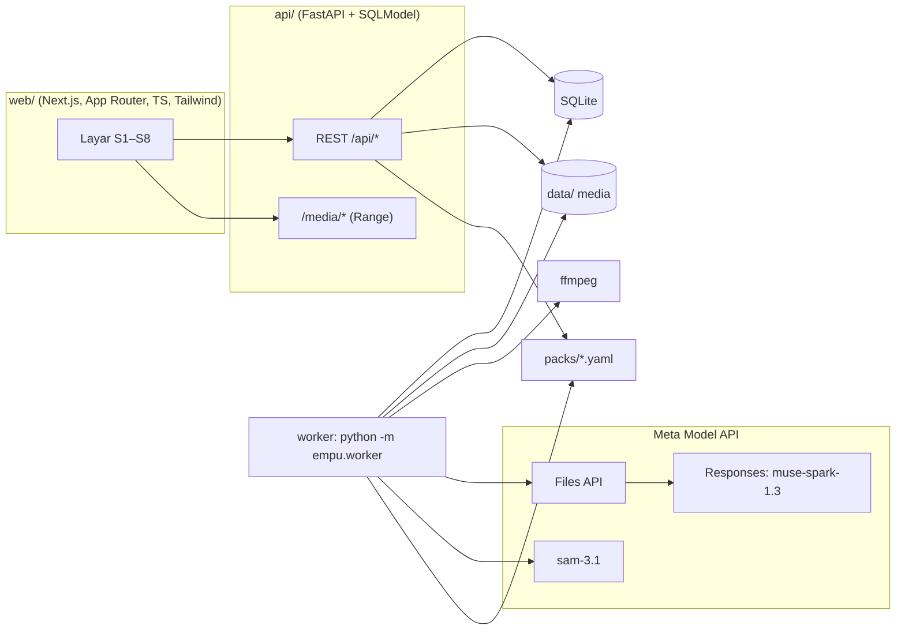

# Empu: Dokumen Desain (Edisi Batik Tulis)

| | |
|---|---|
| Status | Draf siap dijadikan implementation plan, 28 Okt 2026 |
| Pemilik | Syafiq (solo) |
| Konteks | Meta Global AI Developer Hackathon 2026, track Indie. Submission **Kamis 5 Nov 2026, 09:00 WIB** (4 Nov 21:00 ET) |
| Dokumen terkait | `docs/00-konteks-hackathon.md`, `docs/reference/meta-model-api.md`, `docs/reference/prompt-analisis.md`, `docs/reference/muse-output.schema.json`, `docs/reference/hasil-uji-kelayakan.md`, `docs/packs/batik_tulis.yaml`, `docs/eval/` |

Dokumen ini adalah sumber kebenaran. Kalau plan atau kode bertentangan dengan dokumen ini, dokumen ini yang menang, kecuali Syafiq memutuskan lain dan dokumen ini diperbarui.

**Perubahan 28 Okt (keputusan Syafiq):** demo dan kamus publik memakai **video YouTube berlisensi Creative Commons Attribution (CC BY)** dengan atribusi, bukan rekaman sanggar. Video YouTube berlisensi standar tetap hanya untuk evaluasi internal. Rekaman sendiri di sanggar menjadi opsional (lebih kuat kalau sempat). Klaim "divalidasi oleh sang ahli" hanya boleh dipakai untuk entri yang benar-benar dicek oleh kreator atau ahli di video itu; selain itu disebut "divalidasi oleh pendokumentasi". Bagian 4, 9, 12, 13, 14, 15, 16, dan 19 sudah disesuaikan.

---

## 1. Ringkasan

**Empu mengubah video seorang ahli yang bekerja sambil bercerita menjadi kamus keahlian yang bisa ditonton.** Setiap istilah terhubung ke ucapan aslinya, klip gerakannya, dan potongan gambar alatnya. Sang ahli memvalidasi setiap entri sebelum entri itu dipublikasikan.

- **Tagline:** *Capture what masters know, before it's gone.*
- **Edisi pertama:** Batik Tulis. Keterampilan lain ditambahkan lewat *craft pack* (file YAML), bukan lewat kode baru.
- **Arsip Hidup** adalah nama koleksi di dalam aplikasi, misalnya *Arsip Hidup Batik Sanggar X*.

Peran model Meta:

| Model | Peran |
|---|---|
| **Muse Spark 1.3** (video, dan audio kalau Gate 0 lolos) | Menemukan istilah keahlian, waktunya, sumbernya (diucapkan, tertulis di layar, atau hanya terlihat), apa yang terlihat saat itu, arti singkat, dan urutan tahapan proses |
| **SAM 3.1** | Memotong alat atau bahan yang dimaksud dari frame bukti, sehingga setiap entri kamus punya gambar asli |

---

## 2. Masalah

1. Para maestro menyimpan pengetahuan yang tidak tertulis: nama alat dan bagiannya (*nyamplung*, *cucuk*), nama tahap (*nglowong*, *nembok*, *nglorod*), istilah lokal, dan cara melakukannya. Pengetahuan ini hilang bersama generasinya.
2. Merekam itu mudah. Yang mahal adalah mengolah rekaman: mentranskripsi, menemukan istilah, menjelaskan artinya, dan menautkannya ke gerakan yang dimaksud. Banyak rekaman berakhir sebagai file mentah.
3. Pengenal suara umum gagal pada istilah keahlian. Di uji kelayakan, subtitle otomatis YouTube menulis *spangkring* sebagai "spang King", *waterglass* sebagai "watera gelas", dan *nglorod* sebagai "ngelorot".

**Klaim yang boleh dipakai:** pengetahuan dan istilah spesifik para maestro, terutama istilah lokal tiap daerah, tidak terdokumentasi dan hilang bersama generasinya.
**Klaim yang tidak boleh dipakai:** "batik akan punah".

---

## 3. Pengguna

| Pengguna | Kebutuhan | Layar utama |
|---|---|---|
| **Pendokumentasi** (sanggar, komunitas, keluarga pengrajin, peneliti) | Mengunggah rekaman, mencatat izin, memvalidasi hasil, mengekspor | Unggah, Progres, Studio, Ekspor |
| **Maestro atau muridnya** | Mengonfirmasi atau mengoreksi istilah dan arti | Studio (didampingi pendokumentasi) |
| **Pembaca** (murid, publik, peneliti) | Mencari dan menonton istilah | Kamus, Detail entri, Peta tahapan |
| **Juri hackathon** | Paham dan mencoba dalam kurang dari 2 menit | Arsip demo yang sudah terisi, tombol "Coba dengan video contoh", halaman Bukti |

---

## 4. Ruang lingkup hackathon

### Wajib (MVP)
1. Unggah rekaman beserta catatan izin (bagian 13).
2. Pipeline otomatis: normalisasi → potong segmen → analisis Muse → gabung dan normalisasi istilah → klip bukti → potongan SAM (bagian 8).
3. **Studio validasi**: terima, ubah, tolak, atau gabungkan entri.
4. **Kamus**: daftar entri yang bisa dicari, dan halaman detail dengan klip, audio, potongan gambar, arti, varian, dan atribusi maestro.
5. **Peta tahapan** per rekaman.
6. **Ekspor** JSON, CSV, dan ELAN (`.eaf`).
7. **Evaluasi terukur** (bagian 14) dan halaman **Bukti** yang menampilkan angkanya.
8. **Demo dengan video berizin:** video YouTube CC BY (daftar di `docs/eval/test-set.yaml`, bagian `demo_cc_by`) dengan atribusi kreator. Rekaman sendiri di sanggar opsional.
9. **Deploy** dengan URL publik dan arsip demo yang sudah tervalidasi.

### Stretch (urutan prioritas)
1. Tambah entri manual: maestro menyebut istilah yang terlewat, pendokumentasi menandai waktunya, lalu sistem membuat klip dan potongan gambar.
2. Promosi istilah baru ke craft pack (pack ikut belajar dari maestro).
3. Pack kedua (tenun) sebagai stub YAML untuk membuktikan bahwa pack bisa ditukar. Tanpa klaim akurasi.
4. SAM 3.1 *video tracking* pada klip bukti 3 detik (mask bergerak).
5. Perbandingan dengan Muse Wonder.

Catatan: **Mode B (ASR-assisted, bagian 8.4) bukan stretch.** Kalau Gate 0 menunjukkan Muse tidak benar-benar mendengar audio, atau recall istilah yang diucapkan terlalu rendah, Mode B menjadi wajib.

### Tidak dibangun
Aplikasi native, keterampilan lain di luar stub, transkripsi seluruh bahasa daerah, akun multi-pengguna dan peran yang rumit, pembayaran, kursus atau magang digital, paspor produk atau blockchain, dan gambar buatan AI dalam bentuk apa pun.

---

## 5. Prinsip produk (tidak boleh dilanggar)

1. **AI mengusulkan, manusia memutuskan.** Tidak ada entri yang tampil di kamus publik sebelum diterima atau diubah oleh validator.
2. **Bukti selalu terlihat.** Setiap entri menampilkan klip, timestamp, sumber, dan tingkat keyakinan.
3. **Jujur soal sumber.** Bedakan `speech` (diucapkan), `on_screen_text` (hanya tertulis di layar), dan `visual_only` (hanya terlihat bendanya). Label ini tidak boleh hilang di layar mana pun maupun di ekspor.
4. **Gambar asli saja.** Semua gambar berasal dari frame rekaman. Tidak ada gambar buatan AI.
5. **Izin dulu.** Rekaman tidak diproses tanpa catatan izin. Setiap entri punya level akses. Izin bisa dicabut, dan pencabutan langsung menyembunyikan semua turunannya.
6. **Atribusi.** Maestro dicantumkan namanya sebagai kontributor di setiap entri dan ekspor.
7. **Pengetahuan keterampilan tinggal di craft pack.** Kode pipeline tidak boleh berisi istilah batik secara hardcode.

---

## 6. Alur pengguna dan layar

### Alur utama
1. Pendokumentasi membuat arsip (atau memakai yang ada) dan mengunggah rekaman, lalu mengisi data maestro dan izin.
2. Layar Progres menampilkan tahap pipeline sampai siap ditinjau.
3. Di Studio, pendokumentasi dan maestro menonton klip setiap entri lalu menerima, mengubah, menolak, atau menggabungkan.
4. Entri yang diterima dengan akses `public` muncul di Kamus.
5. Ekspor untuk peneliti.

### Layar

| Kode | Layar | Isi pokok |
|---|---|---|
| S1 | Beranda / Daftar arsip | Kartu arsip (jumlah rekaman, entri tervalidasi). Arsip demo disematkan di atas. Tombol "Coba dengan video contoh" |
| S2 | Unggah rekaman | File video, judul, maestro (pilih atau buat baru), lokasi, tanggal, bahasa (default `id,jv`), craft pack, **izin wajib dicentang**, level akses default, catatan izin |
| S3 | Progres | Tahap: normalisasi → analisis segmen (n/m) → penggabungan → potongan gambar → klip → siap. Tampilkan error dengan tombol coba lagi |
| S4 | **Studio validasi** (desktop-first) | Kiri: pemutar video dengan penanda istilah di timeline. Kanan: daftar entri dengan filter (status, sumber, istilah baru, tahap). Kartu entri: klip, potongan gambar, istilah baku, bentuk yang diucapkan, kutipan kalimat, badge sumber, keyakinan, arti ID/EN, tahap. Aksi: Terima, Ubah, Tolak, Gabungkan, Catatan maestro. Pintasan keyboard: `A` terima, `E` ubah, `R` tolak, `J/K` entri berikut/sebelumnya |
| S5 | **Kamus** (mobile-friendly) | Pencarian, filter kategori dan tahap, badge "istilah baru". Detail entri: klip (dengan suara), tombol dengar pengucapan, potongan gambar, arti ID/EN, varian ejaan, maestro, daftar kemunculan di rekaman lain |
| S6 | Peta tahapan | Timeline horizontal tahap proses untuk satu rekaman. Setiap tahap berisi istilah dan thumbnail. Klik untuk loncat ke video |
| S7 | Ekspor | Pilih format (JSON, CSV, ELAN, ZIP) dan cakupan (publik saja atau semua, yang kedua butuh kunci studio) |
| S8 | Bukti | Tabel metrik evaluasi, baseline, dan ablasi dari `eval/results/` (bagian 14), plus penjelasan singkat metode |

Bahasa UI: **Inggris** (juri global). Istilah tetap dalam bentuk aslinya. Arti tersedia dalam bahasa Indonesia dan Inggris. Lihat keputusan terbuka di bagian 17.

---

## 7. Arsitektur



- **Satu codebase Python** (`api/empu/`) berisi pustaka pipeline, server API, worker, dan CLI. Pipeline harus bisa dijalankan tanpa server: `empu analyze <video> --pack batik_tulis` menghasilkan JSON dan file media. Ini memudahkan Gate 1 dan evaluasi.
- **Antrean job berbasis tabel DB.** Worker mengambil job berstatus `queued`. Tidak perlu Redis untuk hackathon.
- **Paralelisme:** analisis segmen berjalan paralel dengan semaphore (default 3).
- **Penyimpanan:** disk lokal di `data/`. Di produksi, media disajikan lewat Caddy atau nginx supaya Range request (seek video) berjalan.
- **Deploy (default):** Docker Compose (web, api, worker, caddy) di VPS yang sudah ada. Alternatif: Railway. Lihat bagian 17.

### Struktur repo (usulan)
```
empu/
├── CLAUDE.md
├── docs/                      # dokumen ini dan rujukannya
├── packs/                     # craft pack (dipindah dari docs/packs saat H1)
│   └── batik_tulis.yaml
├── api/
│   ├── pyproject.toml
│   ├── empu/
│   │   ├── config.py
│   │   ├── models.py          # SQLModel
│   │   ├── packs.py           # loader + validasi pack
│   │   ├── meta_client.py     # SATU-SATUNYA pintu ke Meta API
│   │   ├── pipeline/
│   │   │   ├── normalize.py   # ffmpeg
│   │   │   ├── chunk.py
│   │   │   ├── analyze.py     # Muse per segmen + cache
│   │   │   ├── transcribe.py  # Mode B
│   │   │   ├── merge.py       # offset, dedup, kanonisasi, istilah baru
│   │   │   ├── process_map.py
│   │   │   ├── evidence.py    # klip, audio, keyframe
│   │   │   └── ground.py      # SAM 3.1
│   │   ├── export/            # json, csv, eaf, zip
│   │   ├── routes/
│   │   ├── worker.py
│   │   └── cli.py
│   ├── eval/                  # skrip evaluasi + hasil
│   └── tests/
│       └── fixtures/muse/     # respons Muse terekam (dari uji kelayakan)
├── web/
└── deploy/                    # docker-compose.yml, Caddyfile
```

---

## 8. Pipeline

Status job: `queued → normalizing → chunking → analyzing → merging → grounding → cutting → ready` atau `failed`.

### 8.1 Intake dan izin
- Tolak unggahan jika `consent_confirmed` tidak bernilai `true`.
- Batas default: 500 MB dan 20 menit per rekaman. Unggahan sandbox (juri): 3 menit dan kuota harian.
- Simpan file asli tanpa diubah.

### 8.2 Normalisasi (ffmpeg)
Buat dua turunan:
- `analysis.mp4` untuk Muse: tinggi 480p, H.264 CRF 28 preset veryfast, AAC mono 64 kbps. Setelan ini sudah terbukti di uji kelayakan (sekitar 274 token input per detik video).
- `display.mp4` untuk klip dan keyframe: tinggi 720p, H.264, AAC, `-movflags +faststart`.

Catat durasi lewat ffprobe.

### 8.3 Pemotongan segmen
- Jendela default **75 detik** dengan **overlap 10 detik**. Keduanya bisa diatur di config.
- Alasan: di uji v1, klip 4 menit kehilangan istilah di bagian akhir (*waterglass*, *HCl*) dan timestamp-nya kurang tepat. Segmen pendek juga bisa diproses paralel.
- Video berdurasi 5 menit menghasilkan 5 segmen (mulai di 0, 65, 130, 195, dan 260 detik).

### 8.4 Analisis Muse (per segmen)
1. Hitung `sha256` segmen. Kunci cache: `sha256 + model + prompt_version + mode`. Kalau respons mentah sudah ada di cache, jangan panggil API lagi.
2. Unggah ke Files API (`purpose=user_data`), lalu panggil Responses API dengan `input_video` (`file_id`) ditambah prompt (`docs/reference/prompt-analisis.md`).
3. Prompt berisi konteks dari craft pack: deskripsi keterampilan, kerangka tahapan, dan istilah benih. Istilah benih adalah **contoh, bukan daftar yang harus ditemukan**. Dampaknya diukur lewat ablasi (bagian 14).
4. Minta keluaran JSON sesuai `muse-output.schema.json`. Coba structured output (`text.format` json_schema). Kalau tidak didukung, parse teks lalu validasi dengan Pydantic, dan ulangi sekali dengan pesan galat validasi.
5. Simpan respons mentah, JSON hasil parse, `usage`, dan latensi per segmen.

**Mode A (default): Muse-native.** Video dan audio langsung ke Muse.

**Mode B (ASR-assisted), default sejak Gate 0 (28 Okt).** Bentuk yang dipakai: **koreksi waktu (realign)**, diputuskan Syafiq 28 Okt.
1. Transkripsi audio dengan timestamp per kata memakai **faster-whisper lokal** (`muse-voice-transcribe-1.0` tidak bisa dipanggil, lihat `hasil-gate0.md`).
2. Muse dipanggil persis seperti Mode A (prompt dan cache sama).
3. Untuk setiap istilah `speech`, `evidence_quote` (dan `spoken`) dicocokkan secara fuzzy ke jendela kata transkrip di sekitar waktu Muse (±30 s). Kalau kecocokan cukup (rapidfuzz `partial_ratio` ≥ 80), `t_start`/`t_end` diganti dengan waktu kata yang cocok dan kemunculan ditandai `time_source = asr`. Kalau tidak cocok, waktu Muse dipakai dan ditandai `time_source = muse`. Ejaan istilah tetap dari Muse.
4. Varian lama (transkrip disisipkan ke prompt, prompt sudah tersedia di `pipeline/prompts.py`) hanya untuk ablasi kalau waktu cukup.

### 8.5 Penggabungan dan normalisasi istilah
1. Geser timestamp dengan `chunk.start_s`.
2. **Deduplikasi di zona overlap:** kemunculan dengan istilah baku yang sama dan |Δt| ≤ 4 detik dari segmen berbeda digabung. Pertahankan yang keyakinannya lebih tinggi, atau yang lebih jauh dari tepi segmen.
3. **Kanonisasi ke pack:** cocokkan `term` dan `spoken` (casefold, tanpa tanda baca) dengan `variants` di pack. Kalau tidak ada yang persis cocok, pakai fuzzy match (rapidfuzz, rasio ≥ 90). Kalau cocok, isi `pack_term_id`. Kalau tidak, tandai `is_novel = true` (badge "istilah baru", perlu dicek maestro).
4. **Pengelompokan ke entri arsip:** satu entri per istilah baku per arsip. Kemunculan dari rekaman baru ditambahkan ke entri yang sudah ada, sehingga kamus tumbuh setiap kali ada rekaman baru.
5. Pilih `best_occurrence` per entri dengan prioritas: `source=speech`, lalu `visual_match=yes`, lalu keyakinan tertinggi, lalu durasi terlama.

### 8.6 Peta tahapan
Gabungkan `process_steps` dari semua segmen. Cocokkan nama tahap ke `stages` di pack (lewat id, label, atau varian). Tahap yang tidak cocok masuk ke `other`. Tautkan entri ke tahap berdasarkan waktu dan `stage` dari Muse.

### 8.7 Media bukti (dari `display.mp4`)
Untuk setiap kemunculan:
- **Klip:** `t_start − 1,0 s` sampai `t_end + 1,5 s`, minimal 3 detik dan maksimal 8 detik, MP4 H.264 dengan audio.
- **Audio pengucapan:** rentang yang sama, `.m4a`.
- **Keyframe:** JPG di titik tengah ucapan.

### 8.8 Potongan gambar (SAM 3.1)
- Hanya untuk entri yang istilah di pack-nya punya `visual: true`, atau istilah baru yang `visible`-nya menyebut benda.
- Masukan: keyframe dari `best_occurrence`, dan prompt teks dari `sam_prompt` di pack. Untuk istilah baru, pakai frasa benda dari `visible` (Muse diminta menulis `visible_object_en` yang pendek).
- Keluaran: `crop.png` (bbox ditambah padding 15%), `overlay.jpg` (mask di atas frame), dan `sam_status` (`ok`, `empty`, `error`, `skipped`).
- Fallback kalau hasilnya kosong atau error: tampilkan keyframe utuh dan tandai di Studio.
- Format request dan response SAM belum diverifikasi, jadi tulis adapter `segment_image(image, prompts) -> list[Detection]` dan uji di Gate 0.

### 8.9 Estimasi waktu dan biaya
- Uji v1: klip 2–5 menit butuh 33–42 detik per panggilan (termasuk unggah), dengan input sekitar 274 token per detik dan output 2.200–4.800 token (sebagian besar penalaran).
- Video 5 menit: 5 segmen paralel (semaphore 3) dengan target total **≤ 3 menit** sampai siap ditinjau. Ukur dan laporkan angka aslinya.
- Biaya Muse sekitar USD 0,12 per video 5 menit (harga per listing gateway, belum dicek di halaman resmi Meta).

---

## 9. Model data (SQLModel / SQLite)

| Tabel | Kolom penting |
|---|---|
| `archive` | id, slug, title, craft_pack_id, description, owner_name, default_access, is_demo, is_sandbox, created_at |
| `contributor` | id, name, role (`maestro`/`student`/`documenter`), region, sanggar, bio, created_at |
| `recording` | id, archive_id, contributor_id, title, recorded_at, location, language_hint, duration_s, original_path, display_path, analysis_path, **consent_status** (`granted`/`withdrawn`), **consent_scope** (`public`/`community`/`private`), consent_note, consent_evidence (mis. "izin lisan di 00:05"), **source_kind** (`own_recording`/`cc_by_video`/`internal_eval`), source_url, source_creator, license (mis. `CC BY 3.0`), attribution (teks atribusi siap tampil), status, created_at |
| `job` | id, recording_id, status, progress (0–1), detail ("segmen 3/5"), error, mode (`A`/`B`), model, prompt_version, usage_json, timings_json, started_at, finished_at |
| `chunk` | id, recording_id, idx, start_s, end_s, path, sha256, file_id, status, raw_path, parsed_path, error, usage_json, latency_s |
| `entry` | id, archive_id, term, category, stage_id, gloss_id, gloss_en, variants_json, pack_term_id (nullable), is_novel, **status** (`proposed`/`accepted`/`edited`/`rejected`/`merged`), merged_into_id, **access_level** (`public`/`community`/`private`), best_occurrence_id, crop_path, overlay_path, sam_status, sam_prompt, maestro_note, created_at, updated_at |
| `occurrence` | id, entry_id, recording_id, chunk_id, spoken, term_raw, **source** (`speech`/`on_screen_text`/`visual_only`), t_start, t_end, stage_raw, visible, visible_object_en, visual_match (`yes`/`no`/`not_visible`), gloss_raw, evidence_quote, confidence (`low`/`medium`/`high`), clip_path, audio_path, keyframe_path, status (`proposed`/`accepted`/`rejected`) |
| `process_step` | id, recording_id, pack_stage_id (nullable), name_raw, t_start, t_end, tools_json, order |
| `review_event` | id, entry_id, occurrence_id (nullable), action (`accept`/`edit`/`reject`/`merge`/`restore`/`add_manual`), before_json, after_json, actor, created_at |

Aturan visibilitas publik: `entry.status ∈ {accepted, edited}` **dan** `entry.access_level = public` **dan** rekaman sumber `consent_status = granted` **dan** `consent_scope = public` **dan** `source_kind ≠ internal_eval`. Rekaman `cc_by_video` wajib punya `source_url`, `source_creator`, `license`, dan `attribution` sebelum boleh publik. Kemunculan dari rekaman yang izinnya dicabut tidak pernah ditampilkan. Kalau kemunculan publik sebuah entri habis, entri itu ikut tersembunyi.

Tata letak media:
```
data/archives/<archive_id>/recordings/<recording_id>/
  original.<ext>  display.mp4  analysis.mp4
  chunks/<idx>.mp4
  muse/<idx>.raw.json  muse/<idx>.json
  occurrences/<occurrence_id>/{clip.mp4, audio.m4a, keyframe.jpg}
data/archives/<archive_id>/entries/<entry_id>/{crop.png, overlay.jpg}
data/cache/muse/<cache_key>.json
data/exports/
```

---

## 10. Kontrak API

Semua endpoint di luar `/api/public/*`, `/api/packs*`, `/api/health`, `/api/eval/summary`, dan `/media` (untuk file publik) butuh header `X-Studio-Key` (env `STUDIO_KEY`). Pengecualian: arsip sandbox. Juri boleh mengunggah, melihat progres, dan memvalidasi di arsip sandbox tanpa kunci, tetapi tidak bisa menyentuh arsip lain. Isi arsip sandbox tidak tampil di daftar arsip publik.

| Metode | Path | Keterangan |
|---|---|---|
| GET | `/api/health` | |
| GET | `/api/packs` · `/api/packs/{id}` | Daftar pack dan isinya |
| GET/POST | `/api/archives` | Daftar atau buat arsip |
| GET | `/api/archives/{id}` | Arsip, rekaman, ringkasan statistik |
| POST | `/api/archives/{id}/recordings` | Multipart: `file`, `title`, `contributor_id` atau `contributor_name`, `recorded_at`, `location`, `language_hint`, `consent_confirmed` (wajib `true`), `consent_scope`, `consent_note`, `source_kind` (default `own_recording`), `source_url`, `source_creator`, `license`, `attribution` (empat terakhir wajib kalau `source_kind = cc_by_video`). Respons: `{recording_id, job_id}` |
| POST | `/api/sandbox/recordings` | Seperti di atas, masuk arsip sandbox, maksimal 3 menit, ada rate limit |
| GET | `/api/recordings/{id}` | Detail, status, tautan media |
| POST | `/api/recordings/{id}/reprocess` | Body: `{mode?: "A"\|"B"}` |
| POST | `/api/recordings/{id}/withdraw-consent` | Cabut izin dan sembunyikan semua turunannya |
| GET | `/api/recordings/{id}/process-map` | Tahapan beserta entri |
| GET | `/api/jobs/{id}` | `{status, progress, detail, stages:[{name,status,started_at,finished_at}], error}`. Frontend polling setiap 2 detik |
| GET | `/api/archives/{id}/entries` | Query: `status`, `source`, `is_novel`, `stage`, `q` |
| GET | `/api/entries/{id}` | Entri beserta kemunculan |
| POST | `/api/entries/{id}/review` | `{action, changes?, merge_into_id?, occurrence_id?, actor}` → entri terbaru. Selalu menulis `review_event` |
| POST | `/api/entries` | Tambah manual (stretch): `{archive_id, recording_id, term, t_start, t_end?, gloss_id?}` |
| GET | `/api/archives/{id}/export` | `format=json\|csv\|eaf\|zip`, `scope=public\|all` (`all` butuh kunci) |
| GET | `/api/public/archives/{slug}` · `/entries` · `/api/public/entries/{id}` | Hanya entri yang lolos aturan visibilitas publik |
| GET | `/api/eval/summary` | Membaca `api/eval/results/latest.json` untuk halaman Bukti |
| GET | `/media/...` | File media, wajib mendukung Range |

---

## 11. Kontrak output Muse

Skema lengkap: `docs/reference/muse-output.schema.json`. Prompt: `docs/reference/prompt-analisis.md`.

Ringkasnya, per segmen:
```json
{
  "speech_heard": true,
  "language_notes": "Indonesia bercampur istilah Jawa",
  "transcript_excerpt": "≤300 karakter dari 20 detik pertama",
  "terms": [{
    "spoken": "dilorot", "term": "nglorod", "category": "stage",
    "source": "speech", "t_start": 23.0, "t_end": 24.2,
    "stage": "pelorodan", "evidence_quote": "proses berikutnya adalah ngelorot atau menghilangkan lilin",
    "visible": "kain diaduk di air mendidih", "visible_object_en": "cloth in boiling pot",
    "visual_match": "yes", "gloss_id": "meluruhkan malam dari kain dengan air mendidih",
    "gloss_en": "removing the wax by boiling the cloth", "confidence": "high"
  }],
  "process_steps": [{"step": "pelorodan", "t_start": 20.0, "t_end": 35.0, "tools": ["panci besar"]}]
}
```
Waktu dihitung dalam detik dari awal **segmen**. Enum memakai bahasa Inggris. Uji v1 dan v2 memakai enum berbahasa Indonesia (`ucapan`/`teks_layar`/`visual`, `ya`/`tidak`/`tidak_terlihat`, `rendah`/`sedang`/`tinggi`), jadi fixture lama perlu dipetakan.

---

## 12. Format ekspor

Semua ekspor mencantumkan nama arsip, craft pack dan versinya, maestro, izin, level akses, versi model, versi prompt, dan tanggal ekspor. Untuk rekaman `cc_by_video`, ekspor juga mencantumkan `source_creator`, `source_url`, `license`, dan keterangan bahwa video telah dipotong (syarat atribusi CC BY).

- **JSON** (`empu-dataset.json`): `{manifest, contributors, recordings, entries:[{…, occurrences:[…]}], process_maps}`. Path media relatif terhadap ZIP.
- **CSV** (`entries.csv`): term, category, stage, gloss_id, gloss_en, variants, is_novel, status, access_level, maestro, recording, t_start, t_end, source, confidence, clip_path.
- **ELAN** (`<recording>.eaf`, satu file per rekaman), dibuat dengan `pympi-ling`. Media: `display.mp4`. Tier yang semuanya time-aligned: `term`, `spoken`, `gloss-id`, `gloss-en`, `source`, `stage` (dari peta tahapan). Hanya entri yang lolos cakupan ekspor.
- **ZIP:** JSON, CSV, file `.eaf`, `media/` (klip, audio, crop), dan `README.txt` berisi atribusi dan ketentuan pemakaian.

Lisensi dataset tidak ditentukan oleh aplikasi. Kolom `license` diisi oleh pemilik arsip, default "ditentukan komunitas, hubungi pemilik arsip".

---

## 13. Izin dan akses

- **Sebelum memproses:** centang izin (wajib), cakupan izin (`public`/`community`/`private`), catatan bukti izin (mis. izin lisan direkam di awal video), dan nama maestro.
- **Per entri:** `access_level`, dengan default dari cakupan izin rekaman. Pengetahuan yang dianggap sakral atau rahasia oleh maestro bisa diatur `private`.
- **Pencabutan izin:** satu tombol per rekaman. Semua kemunculan dan media turunannya disembunyikan dari kamus dan ekspor. File tidak dihapus otomatis untuk hackathon, tapi status ini dicatat.
- **Prinsip data:** data tetap milik maestro dan komunitas (prinsip CARE untuk data masyarakat adat). Tidak ada penjualan atau pelatihan model pihak ketiga tanpa izin. Cantumkan ini di halaman tentang dan README.
- **Video YouTube berlisensi standar** hanya untuk evaluasi internal (`source_kind = internal_eval`). Video itu tidak boleh masuk repo, demo, maupun ekspor publik.
- **Video YouTube CC BY** (`source_kind = cc_by_video`) boleh tampil di demo, kamus publik, dan ekspor, dengan atribusi di halaman entri, detail rekaman, ekspor, README, dan video demo. Lisensi diverifikasi dari metadata YouTube dan dicatat di `consent_evidence` (mis. "CC BY, diverifikasi via metadata YouTube 28 Okt 2026"). Hanya channel yang tampak memproduksi videonya sendiri; reupload acara TV tidak dipakai. Videonya sendiri tetap tidak di-commit ke repo.
- **Validasi ahli:** CC BY menyelesaikan hak cipta, bukan persetujuan sang ahli. Kreator dihubungi untuk izin dan validasi jarak jauh (pesan atau video call). Entri yang dicek kreator ditandai `actor = <nama kreator>` di `review_event`; hanya entri itu yang boleh disebut "divalidasi oleh ahli".

---

## 14. Evaluasi

Tujuannya angka yang jujur untuk juri, bukan angka yang terlihat bagus.

### Set uji
- **Utama:** 2–3 video CC BY dari `docs/eval/test-set.yaml` bagian `demo_cc_by` (mis. *Macam Canting dalam Batik Tulis* dan *Proses nyanting batik tulis*), ditambah rekaman sanggar kalau ada. Kunci jawabannya dibuat manual.
- **Pendukung (internal):** klip YouTube berlisensi standar di `docs/eval/test-set.yaml` bagian `clips`, termasuk **klip kontrol** yang hanya berisi musik.
- Catatan: video CC BY umumnya hasil editing (ada musik dan teks di layar). Akurasi label sumber diukur di sana dengan jujur, dan keterbatasan ini disebut di halaman Bukti.
- **Kunci jawaban:** format `docs/eval/kunci-jawaban-template.csv`, satu baris per penyebutan. Draf boleh disusun dari subtitle dan hasil Muse, tapi wajib dikoreksi sambil menonton video, dan pembuatnya dicatat.

### Metrik
| Metrik | Definisi | Target internal |
|---|---|---|
| Recall istilah ucapan | Penyebutan di kunci (`speech`) yang ditemukan dengan istilah baku sama dan \|Δt\| ≤ 5 detik | ≥ 0,70 |
| Presisi | Temuan `speech` yang cocok dengan kunci | ≥ 0,80 |
| Galat waktu | Median \|Δt\| untuk temuan yang cocok | ≤ 3 detik |
| Akurasi label sumber | Ketepatan `speech`, `on_screen_text`, atau `visual_only` | ≥ 0,90 |
| Istilah karangan | Jumlah istilah `speech` di klip kontrol musik | 0 |
| Istilah baru valid | Istilah di luar pack yang diterima validator | Laporkan apa adanya |
| Ketepatan potongan SAM | Persentase potongan yang menurut penilai manusia menunjukkan benda yang benar | ≥ 0,60 |
| Tingkat penerimaan | Entri yang diterima tanpa diubah dibagi semua entri yang ditinjau | Laporkan apa adanya |
| Waktu yang dihemat | Menit kerja manual untuk menyusun glosarium satu rekaman dibandingkan proses Empu ditambah validasi | Laporkan apa adanya |

Target di atas adalah sasaran internal. Di halaman Bukti, laporkan angka aslinya, termasuk yang tidak mencapai target.

### Baseline
- **ASR umum:** subtitle otomatis YouTube (atau Whisper), dicocokkan dengan varian pack. Ini menunjukkan kegagalan pada istilah keahlian.
- **Mode B** sebagai pembanding Mode A.

### Ablasi (diukur pada set yang sama)
1. Segmen 75 detik dibandingkan klip utuh.
2. Dengan istilah benih dibandingkan tanpa istilah benih. Ini mengukur apakah daftar benih menaikkan recall atau malah memancing istilah karangan.
3. Video dengan audio dibandingkan video tanpa audio. Kalau hasilnya sama, berarti Muse membaca bibir, teks, atau menebak dari gambar, bukan mendengar.
4. (Stretch) Muse Spark dibandingkan Muse Wonder.

### Keluaran
- `empu eval run --set docs/eval/test-set.yaml --gold docs/eval/kunci-jawaban --out api/eval/results/<run>.json`
- `empu eval draft-gold <clip_id>` menyusun draf kunci dari subtitle dan hasil Muse untuk dikoreksi manual (lihat `docs/eval/README.md`).
- `latest.json` dibaca oleh halaman Bukti.

---

## 15. Roadmap dan gate

Submission paling lambat **Kamis 5 Nov 09:00 WIB**. Target kirim **Rabu 4 Nov 22:00 WIB**.

| Hari | Tanggal | Fokus | Selesai kalau |
|---|---|---|---|
| H0 | Rab 28 Okt | Dokumen dan plan. **Spike Gate 0.** Hubungi kreator video CC BY (izin dan validasi jarak jauh) | Plan ada di `docs/superpowers/plans/`. Hasil Gate 0 tercatat |
| H1 | Kam 29 Okt | Scaffold repo. `meta_client`, normalisasi, segmen, analisis + cache, validasi skema. CLI `empu analyze` | CLI menghasilkan JSON per segmen untuk 1 video uji |
| H2 | Jum 30 Okt | Penggabungan, kanonisasi, peta tahapan, klip/audio/keyframe, SAM, persistensi DB, worker | **Gate 1** |
| H3 | Sab 31 Okt | Web: Unggah, Progres, Studio. Proses video CC BY demo. (Opsional: sesi rekam sanggar) | Bisa memvalidasi 1 rekaman lewat UI |
| H4 | Min 1 Nov | Kamus, detail entri dengan atribusi, peta tahapan, ekspor JSON/CSV/ELAN. Validasi jarak jauh dengan kreator kalau bersedia | Kamus publik menampilkan entri tervalidasi |
| H5 | Sen 2 Nov | Kunci jawaban, `empu eval`, baseline, ablasi, halaman Bukti | **Gate 2** |
| H6 | Sel 3 Nov | Izin dan akses end-to-end, sandbox, polesan UI, deploy, README | URL publik stabil dengan arsip demo |
| H7 | Rab 4 Nov | Video demo, teks submission, cek akhir. **Kirim** | Terkirim sebelum 22:00 WIB |
| — | Kam 5 Nov | Cadangan saja | |

### Gate
- **Gate 0 (H0, paling lambat Kamis pagi):**
  1. *Apakah Muse benar-benar mendengar?* Jalankan klip *nglowong* dengan audio dan tanpa audio (`ffmpeg -an`). Kalau istilah `speech` tetap muncul sama banyaknya tanpa audio, anggap Muse tidak mendengar dan pakai Mode B.
  2. *Recall ucapan:* jalankan prompt v3 (keputusan 28 Okt) pada klip #NgertiBatik dalam segmen 75 detik, lalu bandingkan dengan 8 istilah yang diucapkan setelah detik ke-80 (daftarnya di `hasil-uji-kelayakan.md`). Kalau kurang dari 6 dari 8, Mode B menjadi default.
  3. *SAM 3.1:* 5 keyframe (canting, wajan, gawangan atau spangkring, kain, malam). Kalau potongan canting gagal di sebagian besar frame, ubah prompt (mis. "hand holding small copper pen"). Kalau tetap gagal, pakai fallback keyframe dan turunkan prioritas SAM.
  4. *Structured output:* cek apakah `text.format` json_schema diterima.
- **Gate 1 (akhir H2):** satu video uji berjalan end-to-end lewat CLI dan worker, menghasilkan entri, klip, dan potongan gambar di DB. Kalau gagal, potong: SAM (pakai keyframe saja), penggabungan lintas rekaman, dan peta tahapan sederhana.
- **Gate 2 (akhir H5):** video demo CC BY (dan rekaman sendiri kalau ada) sudah diproses, divalidasi, dan dievaluasi, dengan atribusi tampil. Aplikasi bisa diakses dari URL. Kalau gagal, potong: ekspor ELAN, sandbox, dan polesan UI. Halaman Bukti tetap wajib.

### Urutan pemotongan kalau waktu habis
1. SAM video tracking → 2. Muse Wonder → 3. Pack stub tenun → 4. Tambah entri manual → 5. Sandbox untuk juri → 6. Ekspor ELAN (JSON dan CSV tetap ada) → 7. Penggabungan lintas rekaman.

**Tidak boleh dipotong:** unggah → proses → validasi → kamus dengan klip, izin dan atribusi, angka evaluasi, dan demo dengan video berizin (CC BY beratribusi atau rekaman sendiri).

---

## 16. Risiko dan mitigasi

| Risiko | Dampak | Mitigasi |
|---|---|---|
| Muse tidak benar-benar memakai audio, atau recall ucapan rendah (v1: hanya 4 dari 8 istilah yang diucapkan tertangkap dengan waktu yang benar) | Inti produk lemah | Gate 0, segmen pendek, prompt v2, Mode B |
| Istilah dari teks di layar tercampur dengan ucapan | Klaim salah | Kolom `source` wajib. Rekaman sendiri tanpa teks di layar |
| Demo tanpa validasi ahli (video CC BY, kreator tidak membalas) | Klaim "divalidasi maestro" hilang, cerita melemah | Hubungi kreator sejak H0 (TEBAK teras batik kaindra, Batik Education). Kalau tidak ada balasan, sebut jujur "divalidasi oleh pendokumentasi". Opsional: satu sesi rekam sanggar atau kelas membatik |
| Lisensi CC BY ternyata tidak sah (uploader bukan pemilik) | Masalah hak cipta | Hanya channel yang memproduksi sendiri; simpan bukti metadata lisensi; atribusi lengkap; reupload TV dibuang |
| Istilah Jawa atau lokal tidak dikenal Muse | Glosa salah | Istilah benih di pack. Badge "istilah baru". Validasi manusia |
| Format API SAM belum jelas | Fitur potongan tertunda | Adapter dan spike Gate 0. Fallback keyframe |
| Rate limit atau error API | Proses macet | Retry dengan backoff (429/5xx, maksimal 4 kali), cache respons mentah, semaphore |
| Hak cipta video uji | Diskualifikasi atau masalah hukum | Video berlisensi standar hanya untuk evaluasi internal. Video CC BY ditampilkan dengan atribusi. Tidak ada video di repo. Manifest hanya berisi ID, lisensi, dan potongan waktu |
| Sensitivitas budaya | Kepercayaan hilang | Izin, level akses, atribusi. Jangan pakai simbol keris tanpa riset. Jangan klaim batik punah |
| Waktu (solo, 7 hari) | Fitur tidak selesai | Gate, daftar potong, pipeline bisa jalan lewat CLI sejak H1 |

---

## 17. Keputusan terbuka (default dipakai kalau belum diputuskan)

| # | Keputusan | Default |
|---|---|---|
| 1 | Repo | Repo baru `empu`, root di folder Empu. Edisi Batik disebut di README |
| 2 | Bahasa UI | Inggris, istilah dalam bentuk asli, arti dalam bahasa Indonesia dan Inggris |
| 3 | Deploy | Docker Compose (web, api, worker, caddy) di VPS yang sudah ada. Alternatif: Railway |
| 4 | Database | SQLite (satu file). Pindah ke Postgres hanya kalau perlu multi-instance |
| 5 | Akses tulis | Kunci studio di header (`STUDIO_KEY`). Juri memakai sandbox |
| 6 | Mode pipeline | **Mode B** (Gate 0, 28 Okt: Muse mendengar audio, tetapi recall dengan waktu hanya 4/8 karena waktu bergeser di segmen yang diawali jeda musik; isi 7/8 benar). Transkripsi: faster-whisper lokal. Mode A tetap jadi pembanding. Lihat `docs/reference/hasil-gate0.md` |
| 7 | Tema submission | "Build for Your World" atau "Push the Frontier". Diputuskan saat submission, tidak memengaruhi build |
| 8 | Sumber video demo | **Diputuskan 28 Okt:** video YouTube CC BY dengan atribusi. Rekam sanggar opsional |

---

## 18. Panduan rekaman sanggar (untuk Syafiq)

- HP posisi landscape, 1080p, tripod. Satu sudut lebar (tangan, kain, alat) dan beberapa close-up canting.
- **Audio paling penting:** mikrofon clip-on di dekat maestro. Tanpa musik latar.
- Di awal video, rekam izin lisan: nama, sanggar, persetujuan, dan apakah ada yang tidak boleh dipublikasikan.
- Minta maestro **menyebut nama setiap alat dan bagiannya sebelum dipakai** ("ini namanya…"), lalu memperagakan setiap tahap secara singkat.
- Rekam 3–5 bagian berdurasi 2–5 menit, satu tahap per bagian.
- Catat istilah lokal yang disebut maestro di kertas. Ini membantu menyusun kunci jawaban.

## 19. Kerangka video demo (2–3 menit)

1. **Hook (15 detik):** perajin bekerja (klip CC BY, atribusi di layar). Teks: "Pengetahuan ini belum pernah ditulis."
2. **Masalah (20 detik):** merekam itu mudah, mengolahnya lama. Contoh subtitle umum yang salah tulis istilah, dari video CC BY *Macam Canting dalam Batik Tulis* (subtitle otomatis menulis *canting* sebagai "cantik"/"cacing"). Tampilkan hanya kalau Empu menangkap istilah itu dengan `source=speech` di waktu yang benar.
3. **Demo (90 detik):** unggah → progres → Studio (terima, ubah satu glosa) → Kamus: ketuk istilah, dengar maestro, lihat klip dan potongan alat → peta tahapan → ekspor ELAN.
4. **Bukti (25 detik):** tabel metrik, baseline, dan klip kontrol yang menghasilkan 0 istilah karangan.
5. **Visi (15 detik):** "Batik hari ini. Tenun dan gamelan berikutnya. Setiap keahlian yang belum pernah tertulis." Tampilkan pack sebagai YAML.
